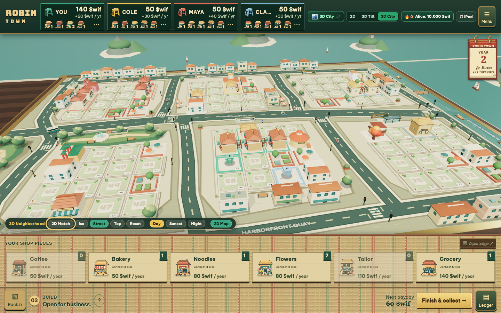
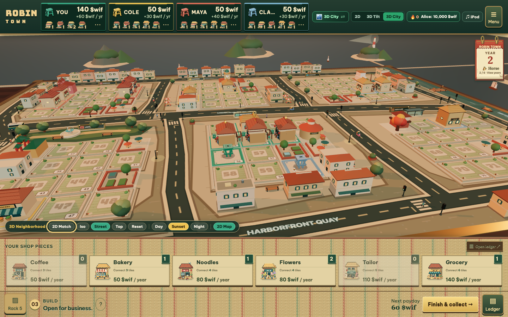
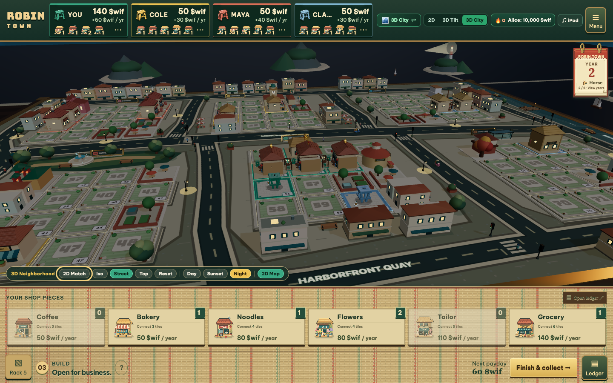
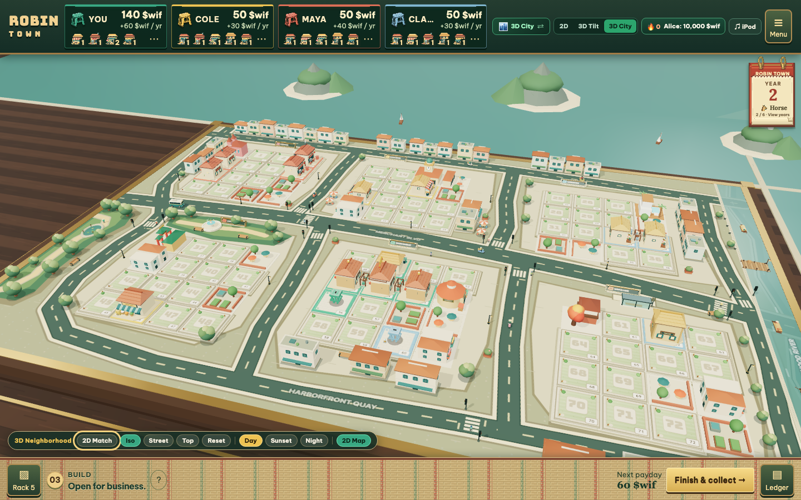

# Robin Town

**Live Playable App**: [https://robin-town-production.up.railway.app](https://robin-town-production.up.railway.app)
**Repository**: [https://github.com/harrymove-ctrl/robin-town](https://github.com/harrymove-ctrl/robin-town)
**Hackathon Demo Video (`3:20`, 1080p)**: [robin-town-hackathon-master.mp4](https://github.com/harrymove-ctrl/robin-town/releases/download/v1.0.0/robin-town-hackathon-master.mp4)
**X Launch Video (`0:44`, 1080p)**: [robin-town-x-launch.mp4](https://github.com/harrymove-ctrl/robin-town/releases/download/v1.0.0/robin-town-x-launch.mp4)
**Verified `$wif` Token (Robinhood Chain)**: [`0xE49A1C3033EcC6b804bc423021D3F71F1A3e0F9B`](https://robinhoodchain.blockscout.com/token/0xE49A1C3033EcC6b804bc423021D3F71F1A3e0F9B)

Robin Town is a Web3 street negotiation and neighborhood business board game built for the **Robinhood Chain Hackathon: Build with `$wif`** (`10,000 USDG` Winner Takes All), adapted from [`phucledien/saigon-town`](https://github.com/phucledien/saigon-town) and inspired by Karsten Hartwig's tabletop classic [Chinatown](https://boardgamegeek.com/boardgame/47/chinatown). It pairs a tactile **3D Harbor Diorama** (with `Day`, `Sunset`, and `Night` lighting, connected multi-lot shophouse clusters, harbor boats, and sidewalk life) with an illustrated `1100x730` Aseprite `2D` and `3D Tilt` street board, cross-device WebSocket multiplayer rooms, and a deflationary `$wif` retention flywheel.

Up to 4 traders (`You`, `Cole`, `Maya`, and `Clara`, or live human players across devices via 6-character room codes) compete across 6 Zodiac Years (`Snake`, `Horse`, `Goat`, `Monkey`, `Rooster`, `Dog`) to claim 72 numbered street plots across 6 harbor districts (`Sherwood`, `Clocktower`, `Harborview`, `Lantern Hall`, `Grand Market`, `Maple Lane`), draw and trade 6 neighborhood storefront types (`Coffee House`, `Corner Bakery`, `Noodle Kitchen`, `Flower Studio`, `Silk Tailor`, `Corner Grocer`), haggle freely in `$wif` at the two-way OTC Bargaining Table, and harvest compounding annual `$wif` paydays.



| Golden Sunset Harbor View | Night Glow Storefronts & Lamps | Isometric Harbor Plinth Overview |
| :---: | :---: | :---: |
|  |  |  |

## How `$wif` Powers the Retention Flywheel

1. **Zero-Friction Casual Town + 3% Point-to-`$wif` Burn**: Anyone can start playing immediately for free with zero crypto upfront (or test with 4 pre-funded `10,000 $wif` instant seats). Every completed deal, placed storefront, and finished match awards **Town Points** redeemable for `$wif` (`10 pts = 1 $wif`) with a **3% permanent burn** to `0x000000000000000000000000000000000000dEaD`.
2. **Ranked `1,000 $wif` Arena + 5% Deflationary Match Burn**: Competitive 4-seat tables pool `4,000 $wif`, awarding **90%** (`3,600 $wif`) to the top-3 podium (`50%` 1st, `25%` 2nd, `15%` 3rd), permanently burning **5%** (`200 $wif`) to `0x000000000000000000000000000000000000dEaD`, and routing **5%** (`200 $wif`) to the neighborhood Staking Vault.
3. **1.20x `$wif` Staking Payday Multiplier**: Locking `500 $wif` in the neighborhood Staking Vault boosts every annual storefront payday by **1.20x**, creating a clear reason to hold and stake `$wif` across matches.
4. **1% OTC Bargaining Cash Micro-Fee**: Every bilateral `$wif` cash transfer settled at the OTC Bargaining Table routes a **1% micro-fee** into the Staking Vault, turning player negotiation volume directly into staker yield.
5. **Verified On-Chain `$wif` Contract & Live Burn Telemetry**: Connects via EIP-1193 wallets to Robinhood Chain alongside ERC-20 calldata encoders (`balanceOf`, `transfer`, `approve`, `burn`) for the verified `RobinWifHat` (`$wif`) token at [`0xE49A1C3033EcC6b804bc423021D3F71F1A3e0F9B`](https://robinhoodchain.blockscout.com/token/0xE49A1C3033EcC6b804bc423021D3F71F1A3e0F9B), streaming live Robinhood Chain block height and the `4,600,000+ $wif` dead-address burn balance directly inside the in-game `$wif` Hub.

## Cross-Device Online Multiplayer (`WebSocket` + `BroadcastChannel`)

Robin Town ships a zero-dependency RFC 6455 WebSocket room relay (`/ws` and `/api/rooms` in [`scripts/ws-relay.mjs`](./scripts/ws-relay.mjs)) paired with a hybrid transport in [`src/network/room.ts`](./src/network/room.ts):

1. Open the **`$wif` Hub** (click the `$wif` wallet pill in the top HUD or `$wif Wallet, Staking & Online Rooms` on the start screen).
2. Under **Section 4 (4-Player P2P Multiplayer Room)**, click **Create 6-Char Room** to generate a live room code (for example `WIF777`).
3. Click **Copy Invite Link** (`https://robin-town-production.up.railway.app/?room=WIF777`) and open that link on another laptop, phone, or browser window to auto-join the table, mark seats ready, and launch synchronized multiplayer turns.

## Visual & Interactive Architecture

* [`src/town/city-3d/`](./src/town/city-3d): Interactive Three.js WebGL **3D Harbor Diorama** (`RobinCity3D` in [`robin-city-3d.ts`](./src/town/city-3d/robin-city-3d.ts) and [`procedural-kit.ts`](./src/town/city-3d/procedural-kit.ts)) featuring a chamfered walnut tabletop plinth, animated harbor waves, timber pier, cargo barges, `Day / Sunset / Night` atmosphere transitions, unified multi-tile cluster terraces, golden monopoly rooftop monuments, and live traffic synced with [`bridge-3d.ts`](./src/town/bridge-3d.ts).
* [`src/town/`](./src/town): Complete 100% English gameplay engine ([`engine.ts`](./src/town/engine.ts), [`trading.ts`](./src/town/trading.ts), [`robin-town-ui.ts`](./src/town/robin-town-ui.ts)), illustrated `1100x730` Aseprite street board, colored ownership stools, tear-off zodiac calendar, woven mat action belt, two-way OTC Bargaining Table, two-page shopkeeper ledger, and Web Audio soundscape.
* [`src/ui/`](./src/ui): SolaceUI `exposure-grid` phase-reactive WebGL2 shader ([`exposure-grid.ts`](./src/ui/exposure-grid.ts)), infinite autoplay district showcase carousel ([`carousel.ts`](./src/ui/carousel.ts)), and collapsible floating `iPod Classic` rotary click-wheel music and phase controller ([`ipod-controller.ts`](./src/ui/ipod-controller.ts)).
* [`src/tokenomics/`](./src/tokenomics) & [`src/network/`](./src/network): Deterministic `$wif` flywheel math ([`flywheel.ts`](./src/tokenomics/flywheel.ts)), dual-mode EIP-1193 + ERC-20 `$wif` wallet adapter ([`wallet.ts`](./src/tokenomics/wallet.ts)), and hybrid `WebSocket` + `BroadcastChannel` multiplayer rooms ([`room.ts`](./src/network/room.ts)).
* [`scripts/serve-prod.mjs`](./scripts/serve-prod.mjs) & [`scripts/ws-relay.mjs`](./scripts/ws-relay.mjs): Production HTTP + gzip static server, `/healthz` readiness probe, `/ws` RFC 6455 room relay, and `/api/onchain-wif` live Robinhood Chain RPC reader.

## Quick Start

```bash
npm install
npm run dev
```

Open `http://127.0.0.1:5173/` in your browser (append `?debug=1` to inspect live QA hitboxes and telemetry).

To run the production server locally with WebSocket rooms and live on-chain `$wif` RPC telemetry:

```bash
npm run build
npm start
```

## Verification and Testing

```bash
npm run verify:assets   # Verify all 69 declared PNG/SVG assets (zero 404s)
npm run typecheck       # Strict TypeScript type checking (tsc --noEmit)
npm test                # Run all 926 unit, integration, WebSocket, and E2E tests
npm run build           # Production Vite bundle into dist/
npm run verify:browser  # Multi-viewport headless Playwright browser verification
```
